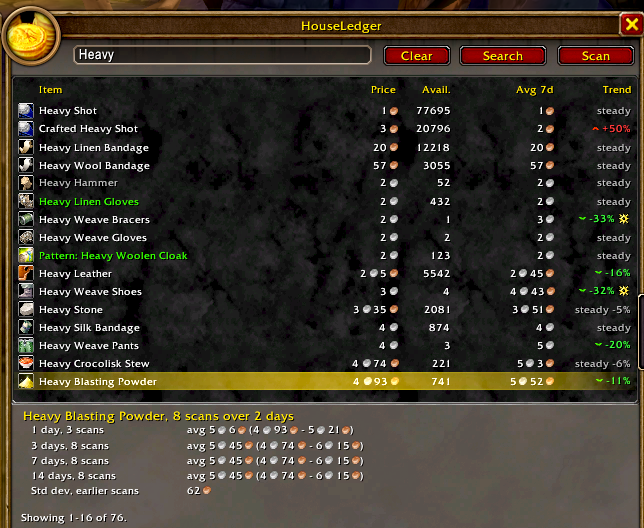
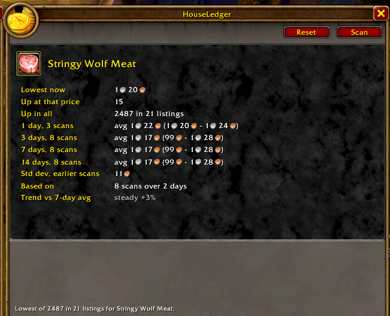

# wow-addons

Free, plain-Lua World of Warcraft addons for the Forever client (interface `16001`).

These are unofficial player addons. They are not affiliated with, endorsed by, or sponsored by Blizzard Entertainment or Microsoft.

**Status: alpha.** HouseLedger is being tested in game. Found a bug or have an idea? [Open an issue](https://github.com/j1d2/wow-addons/issues/new/choose). Every addon here is free and its code stays public, as Blizzard's [UI Add-On Development Policy](https://us.forums.blizzard.com/en/wow/t/ui-add-on-development-policy/24534) requires.

## Addons

| Addon | In one line |
| --- | --- |
| [HouseLedger](#houseledger) | Remembers auction house prices, so you can see what's cheap today and what to sell for. |

## Install

1. Download the addon's latest zip, such as `HouseLedger-0.3.0.zip`, from [Releases](https://github.com/j1d2/wow-addons/releases).
2. Unzip it to get the addon's folder, such as `HouseLedger`.
   - **Windows 11:** right-click the zip, choose **Extract All**, and open the new folder. The `HouseLedger` folder is inside it.
   - **macOS:** double-click the zip.
   - **Linux:** `unzip HouseLedger-0.3.0.zip`
3. Open the game's AddOns folder. In the Battle.net app, select World of Warcraft, click the gear next to **Play**, and choose **Show in Explorer** (Windows) or **Show in Finder** (macOS). Then open `_forever_`, `Interface`, `AddOns`. If `Interface` or `AddOns` isn't there yet, create it. The usual places:
   - **Windows 11:** `C:\Program Files (x86)\World of Warcraft\_forever_\Interface\AddOns`
   - **macOS:** `/Applications/World of Warcraft/_forever_/Interface/AddOns`
   - **Linux (Wine, Lutris and the like):** the same `World of Warcraft/_forever_/Interface/AddOns` path inside your Wine prefix's `Program Files (x86)`
4. Quit the game, then move the addon's folder into `AddOns`. The `.toc` file must sit one level down: `AddOns/HouseLedger/HouseLedger.toc`, not `AddOns/HouseLedger-0.3.0/HouseLedger/HouseLedger.toc`.
5. Start the game. On the character screen, click **AddOns** and make sure the addon is ticked.

**Updating:** quit the game, delete the old addon folder, and move the new one in. Saved prices are kept, because the game stores them in its own `WTF` folder, not in the addon's folder.

---

## HouseLedger

Auction house prices, remembered. One Scan a day builds a 14-day price history on your own computer.

### TL;DR

- **Scan** at the auction house saves today's prices (once each 15 minutes).
- **Hover any item:** the last price, a trend arrow and a deal icon. Hold **Shift** for more.
- **Buy tab:** search, then compare today's price with your 7-day average. Click a row for 1, 3, 7 and 14 days.
- **Sell tab:** drop an item in to see the lowest price now and its history. Then post it in Blizzard's window.
- **Never** buys, posts or scans by itself.

  
  

Buy tab (left) and Sell tab (right). Game art in the screenshots © Blizzard Entertainment, Inc.

### How to use it

1. Open the auction house. HouseLedger's window opens on the right.
2. Click **Scan** once. A deal or trend needs a few scans on different days.
3. **Buy:** type a name, then **Search**. A green arrow means cheaper than usual, and a star means a deal. **Clear** empties the list.
4. **Sell:** drop an item from your bags on the Sell tab, or right-click it in your bags. **Reset** empties the tab.

Its Buy and Sell tabs switch Blizzard's tabs too, and the reverse.

### Good to know

- Prices are the **cheapest asking price**, not what items sold for.
- "1 day" means today's scans. History keeps 14 calendar days.
- Trends start from the 3rd scan, deals from the 5th. A price within 10% of its 7-day average shows as a grey "steady".
- A deal is at least 25% under the average and well below the usual range (2 standard deviations).
- Prices are kept per faction house (Alliance, Horde, neutral) and saved per account in `HouseLedgerDB`.
- In combat the window waits until combat ends before it moves or switches tabs. That's a game rule.

### What it does not do

- It does not post, buy, bid or cancel. You do that in Blizzard's window.
- It does not scan when the auction house opens. A full scan needs your click, at most once each 15 minutes, which is the game's limit.
- Search and Sell send one request per click. Scrolling, hovering and clicking a row send nothing.
- It does not save seller names or send anything to other players.

[`RULES.md`](RULES.md) lists everything these addons may and may not do.

---

## Development

Want to change an addon or build your own? [docs/development.md](docs/development.md) covers the tools for Linux, Windows (WSL 2) and macOS, the checks, trying an addon in game, and releases. [CONTRIBUTING.md](CONTRIBUTING.md) covers how we work.

## Trademarks and copyright

World of Warcraft, WoW, Warcraft, Battle.net, and Blizzard are trademarks or registered trademarks of Blizzard Entertainment, Inc. in the U.S. and/or other countries. Other names are the property of their respective owners.

The code is original addon code. It does not include Blizzard's client files, interface code, or copied text from their games or website. The screenshots in `docs/screenshots/` show these addons in the game. The game art in them is © Blizzard Entertainment, Inc., shown here for noncommercial use under the terms of [Blizzard's legal FAQ](https://www.blizzard.com/en-us/legal/28d5ebbf-c245-4408-8ba9-043dd5f056bf/legal-faq), and is not covered by this project's license. Naming a product or a game API here is only so a reader can find it.

## License

[Apache License 2.0](LICENSE). A pull request is a contribution under that license. The license covers this project's own code. It does not cover Blizzard's games, art, or trademarks. Blizzard's addon policy also applies to any shared copy: it must stay free and readable.
