# wow-addons

Free, plain-Lua World of Warcraft addons for the Forever client (interface `16001`).

Found a bug or have an idea? [Open an issue](https://github.com/j1d2/wow-addons/issues/new/choose). Every addon here is free and its code stays public, as Blizzard's [UI Add-On Development Policy](https://us.forums.blizzard.com/en/wow/t/ui-add-on-development-policy/24534) requires.

## Addons

| Addon | In one line | Get it |
| --- | --- | --- |
| [HouseLedger](#houseledger) | Buy, sell and spot deals at the auction house with your own price history. | [CurseForge](https://www.curseforge.com/wow/addons/houseledger) |
| [Unmaker](#unmaker) | Every item you can disenchant, in one list that remembers what you keep. Clear the rest with one key. | [CurseForge](https://www.curseforge.com/wow/addons/unmaker) |

## Install

### With the CurseForge app (easiest)

Open the addon's CurseForge page, [HouseLedger](https://www.curseforge.com/wow/addons/houseledger) or [Unmaker](https://www.curseforge.com/wow/addons/unmaker), and click **Install**. Or search for it by name in the CurseForge app. The app puts it in the right folder and keeps it up to date.

### By hand

1. Download the addon's latest zip, such as `HouseLedger-0.4.1.zip`, from [Releases](https://github.com/j1d2/wow-addons/releases).
2. Unzip it to get the addon's folder, such as `HouseLedger`.
   - **Windows 11:** right-click the zip, choose **Extract All**, and open the new folder. The `HouseLedger` folder is inside it.
   - **macOS:** double-click the zip.
   - **Linux:** `unzip HouseLedger-0.4.1.zip`
3. Open the game's AddOns folder. In the Battle.net app, select World of Warcraft, click the gear next to **Play**, and choose **Show in Explorer** (Windows) or **Show in Finder** (macOS). Then open `_forever_`, `Interface`, `AddOns`. If `Interface` or `AddOns` isn't there yet, create it. The usual places:
   - **Windows 11:** `C:\Program Files (x86)\World of Warcraft\_forever_\Interface\AddOns`
   - **macOS:** `/Applications/World of Warcraft/_forever_/Interface/AddOns`
   - **Linux (Wine, Lutris and the like):** the same `World of Warcraft/_forever_/Interface/AddOns` path inside your Wine prefix's `Program Files (x86)`
   - New to WoW on Linux? [wow-battlenet-linux](https://github.com/j1d2/wow-battlenet-linux) is a guide to installing Battle.net and WoW Forever with Lutris.
4. Quit the game, then move the addon's folder into `AddOns`. The `.toc` file must sit one level down: `AddOns/HouseLedger/HouseLedger.toc`, not `AddOns/HouseLedger-0.4.1/HouseLedger/HouseLedger.toc`.
5. Start the game. On the character screen, click **AddOns** and make sure the addon is ticked.

**Updating by hand:** quit the game, delete the old addon folder, and move the new one in. Saved prices are kept, because the game stores them in its own `WTF` folder, not in the addon's folder.

---

## HouseLedger

**Your auction house, with memory.** The Buy, Sell and Market tabs all work from a price history kept on your own computer. Every Scan adds to it, and the more you scan, the sharper it gets.

### TL;DR

- **Scan** at the auction house saves today's prices. Scan as often as every 15 minutes; every scan adds to your history.
- **Hover any item:** the last price, a trend arrow and a ⭐ for a deal. Hold **Shift** for the 1, 3, 7 and 14-day averages and ranges.
- **Buy tab:** search, then compare today's price with your 7-day average. Click a row for 1, 3, 7 and 14 days. Before you click one, a house overview shows how many items are listed each day, the trend and a next-day estimate.
- **Buying:** click a row, then the **Buy** button on it to see what's for sale, cheapest first. Type how many (or click a listing), click **Buy**, check the price and how it compares with your 7-day average, then click **Confirm**. Works from the Market tab's deals too.
- **Sell tab:** drop an item in to see the lowest price now and its history. Then post it in Blizzard's window.
- **Market tab:** the deals, biggest drops and biggest rises from your last scan, with no searching until you click **Buy** on one.
- **Settings tab:** turn tooltip prices off, always show the day lines without Shift, or keep 30 or 60 days of prices instead of 14.
- **Price Check:** type `/pc` anywhere, or click **Price Check** above your bags, to look up a saved price by name. Shift-click an item in your bags or a chat link to look it up, scroll through every match, and click a heading to sort.
- **Never** buys, posts or scans by itself: every step is your click.

  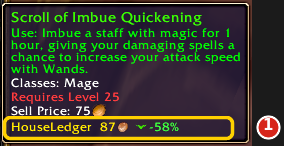
  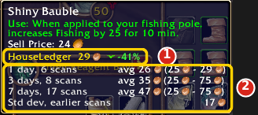

**Tooltips:**
1. **Hover any item** with a saved price: HouseLedger's line shows the last scanned price and its trend (green is cheaper than usual, red pricier, ⭐ a deal).
2. **Hold Shift** for the average and range over 1, 3, 7 and 14 days. The Settings tab can show these without Shift.

  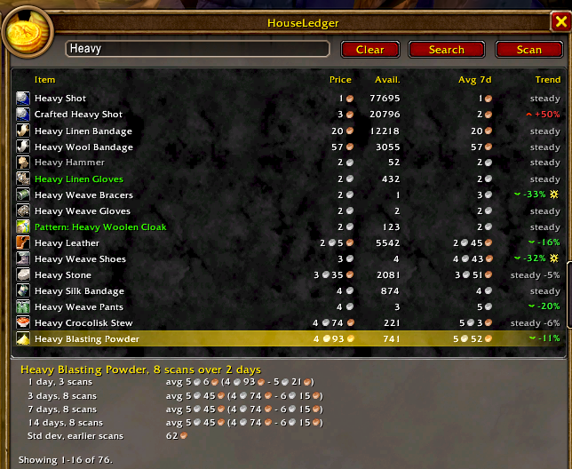
  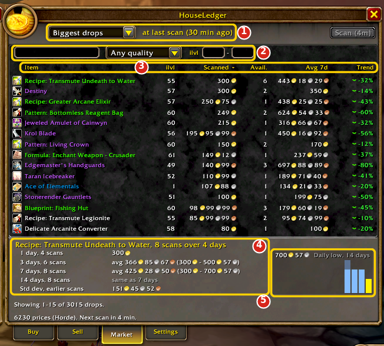

**Buy tab** (left):
1. **Search:** type a name and click **Search**. **Clear** empties the list and the filters.
2. **Filters:** pick a **quality** and an **ilvl** range. With a quality picked you can search with no name. **Show** picks what a search looks for: **Everything**; **Gear for me** (weapons this character can use and its best armor type, like plate for a paladin from level 40, plus rings, necks, trinkets, cloaks, and its shields and relics); **Usable gear** (every armor type too); or **My recipes** (recipes for this character's professions). Picking a quality or a Show choice searches right away; with one picked you can search with no name too.
3. **Columns:** click a heading to sort by it, and again to reverse. **Price** is the cheapest up right now, **Avg 7d** your saved 7-day average, and **Trend** a green arrow for cheaper than usual, red for pricier, grey "steady" about the same, ⭐ for a deal.
4. **Scan:** saves today's prices for the whole auction house. The button counts down the 15 minutes until you can scan again.
5. **Click a row** for its saved prices over 1, 3, 7 and 14 days.
6. **Its chart:** each day's lowest price, today in gold, with a faint band up to that day's highest. It starts at the first day you scanned the item and grows to 14, 30 or 60 days; past 30 days, each bar covers 2 days. Click **Scans** in its corner for one bar per scan instead (the item's last 30), or **Days** to go back. Every chart remembers your choice. From 5 bars, a white **trend line** shows which way the price is going (one odd cheap listing can't tilt it), with a faint band for its normal range, and a purple bar on the right is a guess at the next day or scan.

**House overview:** until you click a row, the space under the Buy list shows your whole auction house. It lists how many items your scans saw at the last scan and on average, the trend per day, an estimate for the next day (after 5 days of scans), and the last scan's listings, units and value. The value counts each item's units at its cheapest price, so a few listings at joke prices don't inflate it. Its chart has one bar per day (the last scan's day in gold), a white trend line, a faint band for the normal range around it, and a purple bar for the next-day estimate. Items listed per day come from the scans you've already saved; listings, units and value start with your next scan. All of it reads saved data only.

**Market tab** (right): your last scan, with no searching. It reads only saved prices and sends nothing until you click **Buy** on a picked row.
1. **View:** Deals, Biggest drops or Biggest rises, and how long ago you scanned.
2. **Filters:** name, quality and ilvl (the item's base level).
3. **Columns:** sortable like Buy. **Scanned** is the price at your last scan.
4. **Click a row** for its day lines and (5) its chart.

  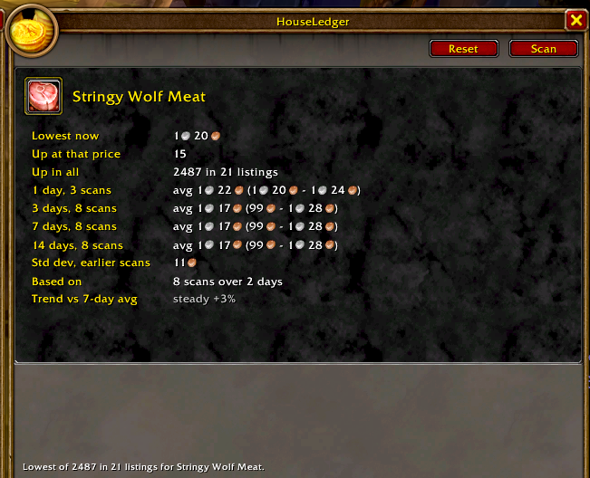
  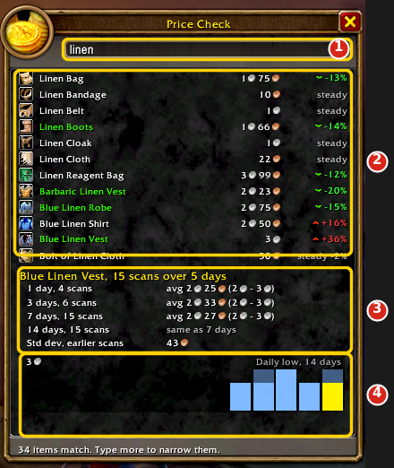

**Sell tab** (left):
1. **Drop an item** here, or right-click it in your bags.
2. **Right now:** the lowest price up, how many are at that price, and how many in all.
3. **History:** your saved averages and ranges over 1, 3, 7 and 14 days.
4. **Trend** against your 7-day average, and the **typical** price.
5. **In plain words:** whether today's price is high, low or about normal.
6. **Its chart.** **Reset** empties the tab.

**Price Check** (right): type `/pc` (or `/pricecheck`) anywhere, no auction house needed.
1. **Search** your saved prices by name.
2. **Results:** the last price and trend.
3. **Click a result** for its day lines and (4) its chart.

Scroll with the mouse wheel; the line at the bottom says which matches show and how many there are. Click **Item**, **Price** or **Trend** to sort, and again to reverse. With Price Check open, shift-click an item in your bags or a chat link to look it up.

  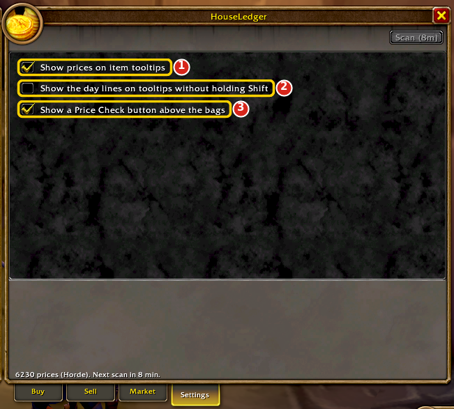
  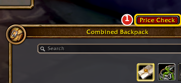

**Settings tab** (left):
1. **Tooltip prices** on or off.
2. **Day lines on tooltips** without holding Shift.
3. **The Price Check button** above your bags (right) on or off.
4. **Price history:** keep 14, 30 or 60 days. Longer history uses more memory and makes a bigger saved file: 60 days takes about three times as much as 14. Going back to 14 drops the older days right away.

Game art in the screenshots © Blizzard Entertainment, Inc.

### How to use it

1. Open the auction house. HouseLedger's window opens on the right.
2. Click **Scan** once. A deal or trend needs a few scans on different days.
3. **Buy:** type a name, then **Search**. A green arrow means cheaper than usual, and a star means a deal. **Clear** empties the list.
4. **Sell:** drop an item from your bags on the Sell tab, or right-click it in your bags. **Reset** empties the tab.

Its Buy and Sell tabs switch Blizzard's tabs too, and the reverse.

### Good to know

- Prices are the **cheapest asking price**, not what items sold for.
- "1 day" means today's scans. History keeps 14 calendar days.
- Trends start from the 3rd scan, deals from the 5th. A price within 10% of its 7-day average shows as a grey "steady".
- A deal is at least 25% under the average and well below the usual range (2 standard deviations).
- Prices are kept per auction house (Alliance, Horde and goblin) and saved per account in `HouseLedgerDB`. At a goblin auction house the window shows the goblin prices; tooltips always show your own faction's.
- In combat the window waits until combat ends before it moves or switches tabs. That's a game rule.

### What it does not do

- It buys only at the buyout price, and only when you click Buy and then Confirm. It does not post, bid or cancel. You do that in Blizzard's window.
- After a buy it doesn't search again by itself; click Back, then Buy, to see what's left. What you buy arrives in your mailbox.
- It does not scan when the auction house opens. A full scan needs your click, at most once each 15 minutes, which is the game's limit.
- Search, a row's Buy and Sell send one request per click. Scrolling, hovering and clicking a row send nothing.
- It does not save seller names or send anything to other players.

[`RULES.md`](RULES.md) lists everything these addons may and may not do.

---

## Unmaker

**Stop digging through your bags for things to disenchant.** Unmaker lists every item you can disenchant in one window. Uncheck what you keep, then clear the rest one click at a time.

### TL;DR

- **Open it** with `/unmaker` (or the short `/um`), or the **Unmaker** button above your bags.
- **Every Uncommon, Rare and Epic** weapon and armor piece in your bags is listed, with its item level and vendor price. **Uncheck** what you want to keep; Unmaker remembers. Filter by quality and item level, and click a heading to sort.
- **Disenchant next** disenchants the next checked item. One click per item, which is Blizzard's rule. Bind it to a key in the game's Key Bindings menu.
- **Epics and soulbound gear start unchecked.** Change that on the **Settings** tab.
- **What it gives:** the **Gives** column shows each item's likely materials and their chances, and every item tooltip (bags, links, the auction house) says what it disenchants into. Once you've disenchanted 5 of a kind of item, your own results replace the guide's numbers.
- **Stats and History tabs:** how many items you've unmade (this session, today, lifetime) on each character and all of them together, the materials you got, fun facts, and a sortable list of every recent disenchant.
- **Never** disenchants without your click, and does nothing in combat.

  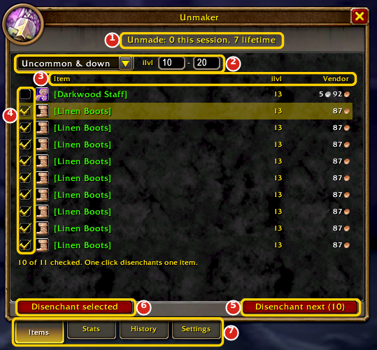
  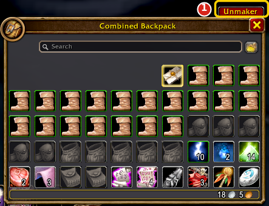

**Items tab** (left):
1. **Unmade:** how many items you've disenchanted this session and in total.
2. **Filters:** pick a quality ("Rare & down", "Uncommon & down") and an item level range. The line under the list says how many items the filters hide.
3. **Headings:** click Item, ilvl or Vendor to sort, and again to reverse. **Vendor** is what a vendor would pay for the item.
4. **Checkboxes:** uncheck what you want to keep. Unmaker remembers.
5. **Disenchant next:** one click disenchants the next checked item shown in the list (filters and sorting change which one is next). You can bind it to a key.
6. **Disenchant selected:** disenchants only the row you clicked, if it's checked.
7. **Tabs:** Items, Stats, History, Kept and Settings.

**Bag window** (right):
1. The **Unmaker** button above your bags opens and closes the window.

  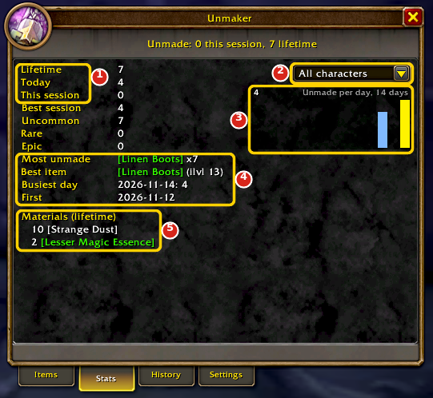
  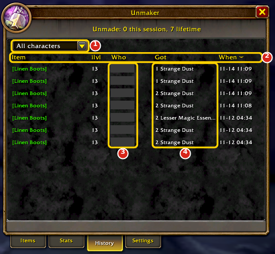

**Stats tab** (left):
1. **Counts:** lifetime, today and this session.
2. **Characters:** the dropdown picks all your characters together or one of them.
3. **Chart:** how many items you unmade each day for 14 days, today in gold. It follows the dropdown.
4. **Fun facts:** your most-unmade item, best item, busiest day and first disenchant.
5. **Materials:** everything your disenchants have given you.

**History tab** (right):
1. **Characters:** show every character's disenchants, or just one character's.
2. **Headings:** click one to sort, and again to reverse. Dates read month-day, then time; hover a row to see the year.
3. **Who:** the character that unmade the item (names are hidden in this picture).
4. **Got:** the materials each disenchant gave.

  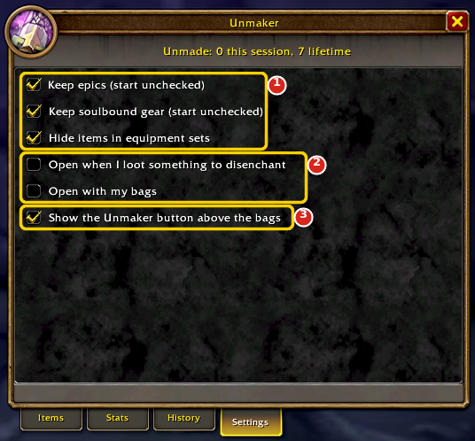

**Settings tab:**
1. **What starts unchecked or hidden:** epics, soulbound gear and items in your equipment sets.
2. **When the window opens by itself:** when you loot gear to disenchant, or with your bags (and it closes with them too). Only on characters that know Disenchant.
3. **Bag button:** show or hide the Unmaker button above your bags. On by default; `/unmaker` or `/um` opens the window either way.
4. **History length:** keep 500, 1,000, 5,000 or 10,000 disenchants in the History tab. The Stats totals count every disenchant either way.

Game art in the screenshots © Blizzard Entertainment, Inc.

### How to use it

1. Open the window. It needs a character that knows Disenchant (Enchanting).
2. Uncheck anything you want to keep.
3. Click **Disenchant next** once per item, and take the loot. The button waits until the loot window closes, then moves to the next item.
4. Or click a row and use **Disenchant selected** for just that item. It only works on a checked item.

### Good to know

- An item you uncheck stays unchecked next time, on every character. Checking an Epic or soulbound item only lasts until you log out.
- Before every cast, Unmaker checks the bag slot still holds that exact item. If your bags changed, nothing happens and the list updates.
- Items in a saved equipment set are hidden.
- If a disenchant fails (you moved, say), the item stays on the list and the window shows the game's reason. If the game won't disenchant an item at all, uncheck it.
- **Settings tab:** keep epics, keep soulbound gear, hide equipment-set items, open when you loot gear to disenchant, open and close with your bags, and show or hide the Unmaker button above your bags.
- With a fast-loot addon the button may stay locked a little longer. It unlocks by itself after 10 seconds.
- **Stats tab:** items unmade this session, today, lifetime and in your best session; counts by quality; your most-unmade item, best item and busiest day; and lifetime materials. Pick all your characters together or one of them from the dropdown at the top. A 14-day chart shows how many you unmade each day.
- **History tab:** your last 500 disenchants (up to 10,000 from Settings), newest first, and who unmade each. Pick a character from the dropdown to see only theirs. Click **Item**, **ilvl**, **Who** or **When** to sort, and again to reverse.
- **Gives and tooltips:** the chances come from your own results once you have 5 disenchants of that kind of item (same quality, armor or weapon, and item-level range). Until then they come from [warcraft.wiki.gg's disenchanting tables](https://warcraft.wiki.gg/wiki/Disenchanting_tables) (CC BY-SA 4.0), plus two places where Forever is different: blues below item level 20 give dust or essence like a green, one more of each (blue weapons below 16 show nothing until you've disenchanted some), and green weapons from item level 21 to 30 give Greater Magic Essence. Those two follow what other Forever players' tools report; so far Unmaker's own results have confirmed one blue. The tooltip shows each material as its icon with its chance (and how many, when more than one), and says where the numbers come from: "Guide", "Forever rule" for those two, or "From 12 of yours". Turn the tooltip lines off in **Settings**.
- **Kept tab:** every item you've unchecked, so Unmaker keeps it, in or out of your bags. Click **Forget** to put one back: it starts checked again, unless a setting keeps it (like Keep epics).
- Every character can see every character's stats and the shared history. They only count disenchants done with Unmaker's buttons.

### What it does not do

- It never disenchants more than one item per click, never clicks for you, and never casts from a timer.
- It does nothing in combat. The window waits until the fight ends to open or close.
- It doesn't sell, mail, or delete anything, and it sends nothing to other players.

---

## Development

Want to change an addon or build your own? [docs/development.md](docs/development.md) covers the tools for Linux, Windows (WSL 2) and macOS, the checks, trying an addon in game, and releases. [CONTRIBUTING.md](CONTRIBUTING.md) covers how we work.

## Trademarks and copyright

These are unofficial player addons. They are not affiliated with, endorsed by, or sponsored by Blizzard Entertainment or Microsoft.

World of Warcraft, WoW, Warcraft, Battle.net, and Blizzard are trademarks or registered trademarks of Blizzard Entertainment, Inc. in the U.S. and/or other countries. Other names are the property of their respective owners.

The code is original addon code. It does not include Blizzard's client files, interface code, or copied text from their games or website. Unmaker's disenchant chances (`addons/Unmaker/UnmakerResults.lua`) are based on [warcraft.wiki.gg's Disenchanting tables](https://warcraft.wiki.gg/wiki/Disenchanting_tables), used under [CC BY-SA 4.0](https://creativecommons.org/licenses/by-sa/4.0/). The screenshots in `docs/screenshots/` show these addons in the game. The game art in them is © Blizzard Entertainment, Inc., shown here for noncommercial use under the terms of [Blizzard's legal FAQ](https://www.blizzard.com/en-us/legal/28d5ebbf-c245-4408-8ba9-043dd5f056bf/legal-faq), and is not covered by this project's license. Naming a product or a game API here is only so a reader can find it.

## License

[Apache License 2.0](LICENSE). A pull request is a contribution under that license. The license covers this project's own code.

One exception: the disenchant table data in `addons/Unmaker/UnmakerResults.lua` (marked in the file) comes from [warcraft.wiki.gg's Disenchanting tables](https://warcraft.wiki.gg/wiki/Disenchanting_tables) and is shared under [CC BY-SA 4.0](https://creativecommons.org/licenses/by-sa/4.0/), as that page is. It does not cover Blizzard's games, art, or trademarks. Blizzard's addon policy also applies to any shared copy: it must stay free and readable.
